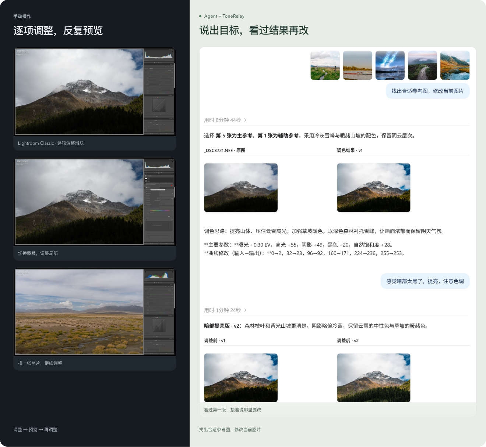
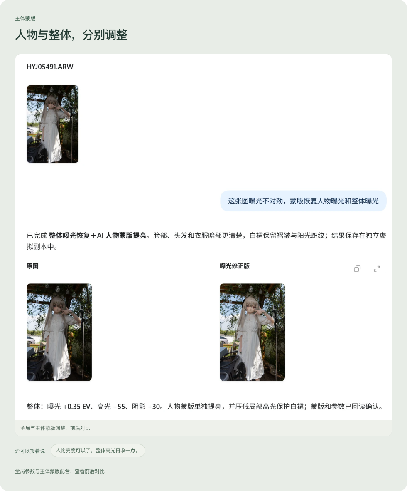
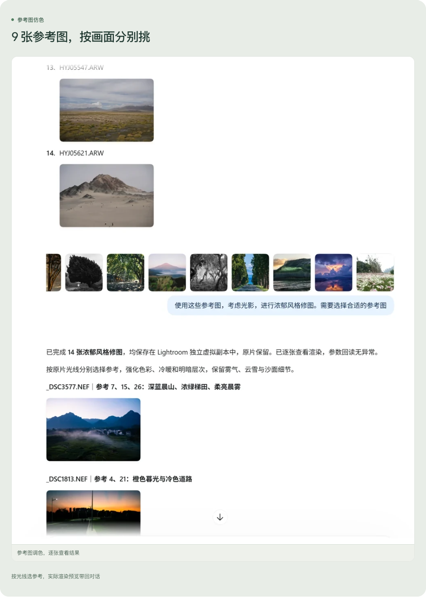
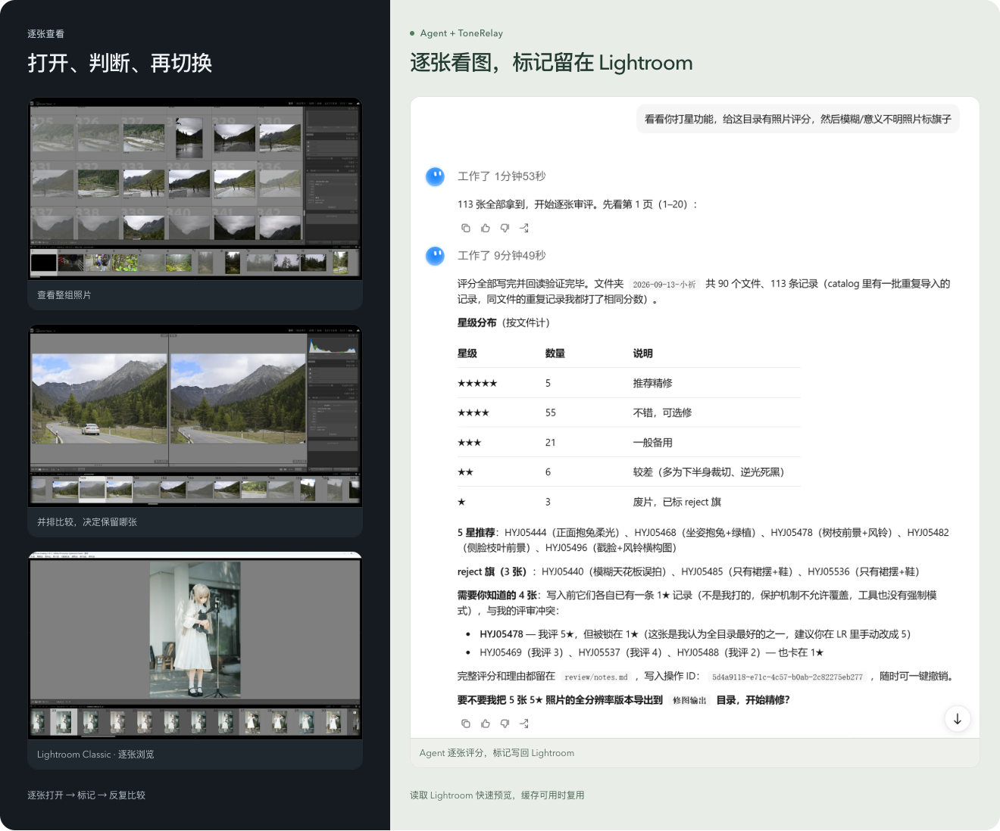

# ToneRelay — Adobe Lightroom Classic MCP

[中文](README.md) · [English](README.en.md)

### Describe the look you want, and refine your photos with an AI agent.

> Source preview: source code and installation instructions are available, but no stable installer has been released and full cross-platform acceptance has not been declared. Pin a commit when installing, and verify your actual environment using [INSTALL.en.md](INSTALL.en.md).

A local Model Context Protocol (MCP) server for Adobe Lightroom Classic: conversational AI photo editing, reference-based color matching and color grading, subject masks, photo previews, and batch photo culling through an AI agent. View your selected photo and folder previews, refine people and lighting, then keep discussing the result. Edits remain in Lightroom Classic.

**[See real workflows](https://reefruan.github.io/tonerelay-portal/?lang=en#experience) · [Style and effect gallery](https://reefruan.github.io/tonerelay-portal/?lang=en#gallery) · [Install and use](https://reefruan.github.io/tonerelay-portal/?lang=en#experience) · [Contact the author](https://reefruan.github.io/tonerelay-portal/contact.html?lang=en)**

[Installation guide](INSTALL.en.md) · [Usage guide](USAGE.en.md) · [Copy the installation prompt](#copy-this-prompt-to-your-agent) · [Portal repository](https://github.com/ReefRuan/tonerelay-portal) · [Bilibili](https://space.bilibili.com/2869626) · [Star MCP](https://github.com/ReefRuan/tonerelay-lightroom-mcp)

## Recommended: explore the style gallery first

<a href="https://reefruan.github.io/tonerelay-portal/?lang=en#gallery"></a>

**[Open the gallery and find your direction →](https://reefruan.github.io/tonerelay-portal/?lang=en#gallery)**

Not sure which look to try? We strongly recommend exploring reference photos with different styles, then bringing a favorite direction into the conversation. The thumbnail opens the gallery too. These are style references, not a promise of results from applying a preset.

## See a first version, then keep refining

> “The shadows feel too dark. Adjust them a little more.”

Discuss the look you want, or share a reference image. After the agent produces a first version, continue refining shadows, highlights, warmth, and depth. The following example shows a real workflow with further refinement based on feedback in the same conversation.

[](assets/readme/dialogue-workflow.png)

The left shows Lightroom itself; the right shows the reference, two rounds of conversation, and their results. Click to enlarge, or [explore more on Portal](https://reefruan.github.io/tonerelay-portal/?lang=en#experience).

## From one photo to a whole set

| What you want to do | What you can say |
| --- | --- |
| View the selected photo and nearby images | “Show my currently selected photo, then show 10 previews from the same folder.” |
| Match color and tone to a reference | “Use this reference's color temperature and tonal depth to try a first version on the current photo.” |
| Refine a person and the background | “Keep the background's current feel, and refine the subject's exposure and shadows.” |
| Cull and organize photos | “Review this set and suggest ratings and flags first. Write them back only after I confirm.” |
| Explore styles and effects | “Browse the gallery styles and discuss which one suits this photo.” |

### Balance subject exposure with overall lighting

> “Use a mask to restore the subject's exposure, and adjust the overall exposure too.”

Combine global tone changes with local subject adjustments. Review the actual image, then refine brightness, edges, and the balance of the scene.

[](assets/readme/subject-mask.png)

### Apply a reference direction across several photos

Lighting and subjects vary from one photo to another. The agent can assess each image against the references, then bring the adjustments back into Lightroom for review.

[](assets/readme/reference-color.png)

### Keep your culling decisions in Lightroom

After reviewing and comparing photos, write ratings, flags, or color labels for the confirmed task while protecting existing marks.

[](assets/readme/batch-workflow.png)

These presentation images come from Portal; trimming and rounded corners are for page layout only. The Lightroom and agent conversations within them come from the author's earlier real workflows; photo editing was not rerun for the capture. No photos were redrawn, conversations altered, or results fabricated. They are not speed or token-use benchmarks. [View the original material sources](https://github.com/ReefRuan/tonerelay-portal/blob/main/public/experience/SOURCES.md). Results depend on the photo, reference target, and model used. Screenshots retain their original interface and conversation language.

## Get started

**[Install and use on Portal →](https://reefruan.github.io/tonerelay-portal/?lang=en#experience)**

[Full installation and recovery guide](INSTALL.en.md) · [Everyday usage](USAGE.en.md) · [Copy the prompt below](#copy-this-prompt-to-your-agent)

You need Lightroom Classic and an agent client that supports local MCP servers. Open your target Catalog in Lightroom and select a photo. After installation, say:

> Start editing in Lightroom.

A complete installation includes the Lightroom plug-in, ToneRelay MCP, and the client startup Skill. Use this repository's **[INSTALL.en.md](INSTALL.en.md)** for supported entry points, client setup, and platform-specific instructions. You can also give your agent the **[installation prompt retained in Portal](https://github.com/ReefRuan/tonerelay-portal/blob/main/docs/install-prompt.en.md)**.

## Source installation

Once you have obtained and verified the source for a fixed commit in this repository, you need Python 3.10 or later. Follow the [installation guide](INSTALL.en.md) to place the source in a dedicated installation directory, then run the appropriate platform entry point from that source root using the verified version identifier.

macOS:

```sh
python3 plugins/tonerelay-lightroom/scripts/tonerelay_bootstrap_macos.py install \
  --source-root "$HOME/Library/Application Support/ToneRelay/downloads/source" \
  --version "fixed-version-label" --manage-source
```

Use `--manage-source` only for a dedicated source download created for this installation, so the uninstaller can clean it up using its manifest. Do not add it for an existing development checkout; that checkout is read-only installation input. Custom paths must match the actual configured download location.

Windows PowerShell:

```powershell
python plugins/tonerelay-lightroom/scripts/tonerelay_bootstrap.py install `
  --source-root "C:\path\to\verified-source" --version "fixed-version-label"
```

The installer reports the Lightroom plug-in location, maintenance entry point, MCP client configuration, and `next` steps. On both platforms, use the returned maintenance entry point to run `lightroom-plugin install` and register the Lightroom plug-in. Installing only the Runtime does not complete setup. Configure MCP and the startup Skill for each client, then verify the connection and selected photo in a real conversation. Use each platform's own installer; native Windows behavior must be confirmed in the actual environment. [Installation FAQ](https://github.com/ReefRuan/tonerelay-portal/blob/main/docs/faq.en.md)

On macOS, also record each connected client in the installation manifest using `record-client`. JSON `mcpServers` configurations and officially managed/TOML configurations use different registration modes; see [Record each client](INSTALL.en.md#record-each-client-macos). The original Windows entry point does not support `--manage-source` or `record-client`; do not mix platform arguments.

## Dependency download help

If Python dependency downloads fail, retain the installation error and logs first, then follow the [public FAQ's installation troubleshooting guidance](https://github.com/ReefRuan/tonerelay-portal/blob/main/docs/faq.en.md). If you change `PIP_INDEX_URL`, use a verified download source. Do not disable TLS verification or install dependencies from unknown sources. Resume the existing installation after recovery; reinstalling must not mean deleting photos, Catalogs, or editing data.

## Photos and edits

Normal Develop workflows preserve the original photo through separate virtual copies. You can review existing versions and continue refining them. Ratings, flags, and color labels are written to the Catalog for the confirmed task. Direct file operations, such as RAW sidecar changes, require explicit authorization and specified targets. Use Lightroom's actual readback and returned images as evidence of execution.

ToneRelay is an independent project, not an official Adobe product, and is not affiliated with or endorsed by Adobe. This integration targets **Lightroom Classic**; it does not imply support for cloud-based Lightroom or Photoshop.

## License

Copyright (C) 2026 Reef Ruan.

The author's original code, runtime prompts, Skills, and documentation in the current version of this repository are licensed under [GNU AGPL-3.0-only](LICENSE), matching [Portal](https://github.com/ReefRuan/tonerelay-portal). Third-party dependencies retain their respective licenses; this project does not license Adobe software, products, or trademarks. Photos, reference images, and screenshot materials are not covered by the code's AGPL grant; their [sources and original licenses](https://github.com/ReefRuan/tonerelay-portal/blob/main/public/experience/SOURCES.md) apply. Historical commits retain the licenses distributed with them; Git history has not been rewritten.

Author: [GitHub](https://github.com/ReefRuan) · [Bilibili](https://space.bilibili.com/2869626) · [Contact](https://reefruan.github.io/tonerelay-portal/contact.html?lang=en).

## Copy this prompt to your agent

Use the copy button at the top-right of the code block, then paste it into your current agent. This is a short entry prompt, not the full procedure: the agent should first read the linked complete installation prompt and this repository's installation guide. The complete prompt remains at its original Portal path.

```text
Please install or connect ToneRelay for Lightroom Classic in the current Agent client.
First read the complete installation prompt: https://github.com/ReefRuan/tonerelay-portal/blob/main/docs/install-prompt.en.md
And the installation guide: https://github.com/ReefRuan/tonerelay-lightroom-mcp/blob/main/INSTALL.en.md

Start with read-only checks of the OS, client, Lightroom, and existing ToneRelay installation, including its source, pinned version, and health. Reuse a healthy, compatible installation; connecting this client does not authorize reinstalling or upgrading shared components. If downloading is necessary, verify the identity, public accessibility, and fixed commit of the official ReefRuan/tonerelay-lightroom-mcp repository, then follow that version's platform instructions. If verification fails, report it; do not use internal repositories or unknown sources.

Complete the necessary MCP, Lightroom plug-in, and client connection. If the client supports Skills, connect the matching-version startup Skill. Use a dedicated installation directory and record ownership. Preserve photos, Catalogs, presets, and other MCP configuration. Explain the impact and obtain the relevant authorization for Catalog binding, mode or shared-component changes, and any action requiring the user's own confirmation.

Verify tool discovery, health, and the current photo through read-only checks in a real new session in this client, including actual loaded versions and paths. A running process is not acceptance. Do not modify photos or Catalog contents during verification. Mark anything unobservable as pending; do not declare success without evidence.
```

<a href="https://reefruan.github.io/tonerelay-portal/?lang=en#experience"><kbd>Open Install &amp; use →</kbd></a> · **[Read the complete installation prompt →](https://github.com/ReefRuan/tonerelay-portal/blob/main/docs/install-prompt.en.md)**
