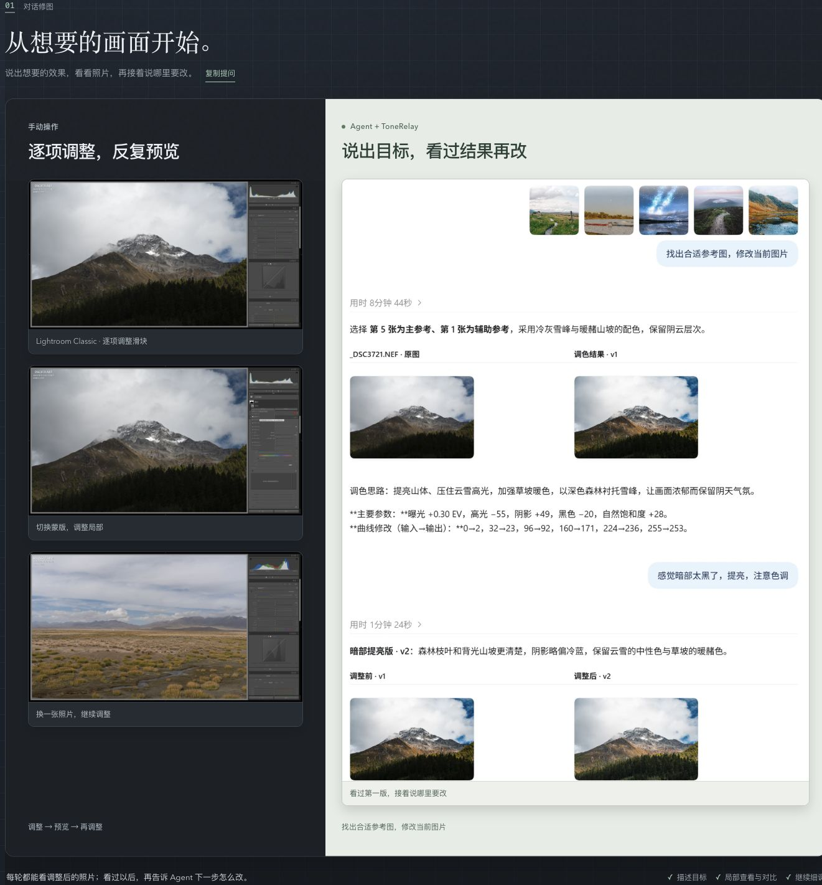
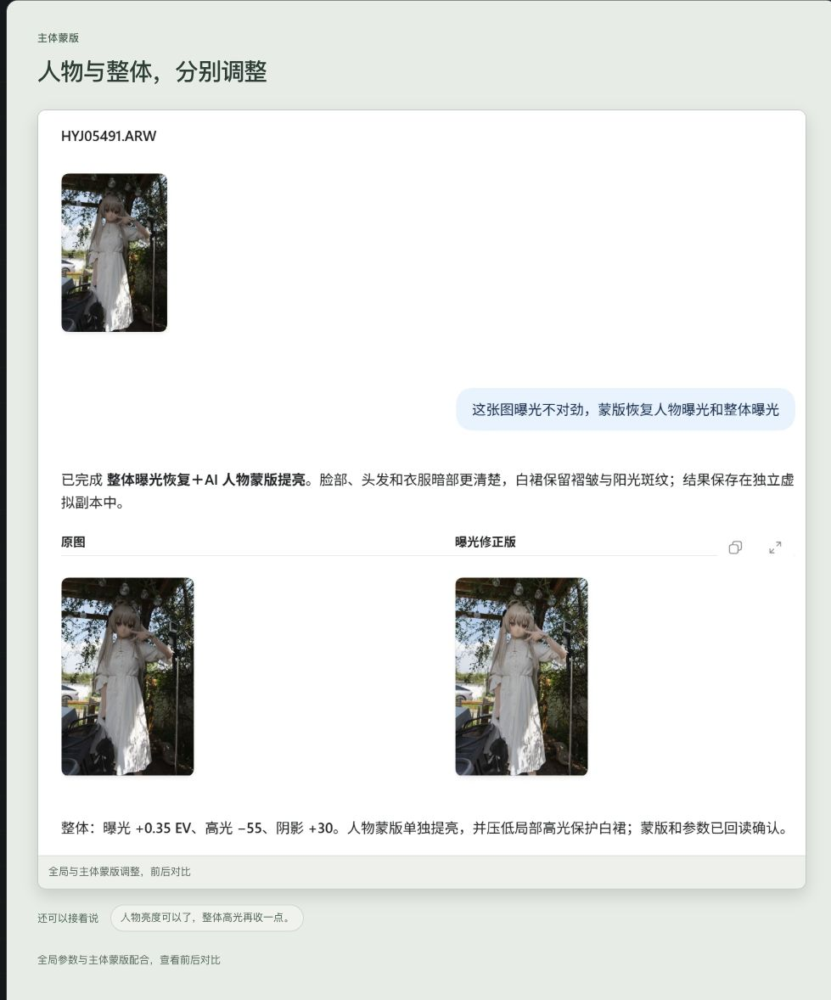
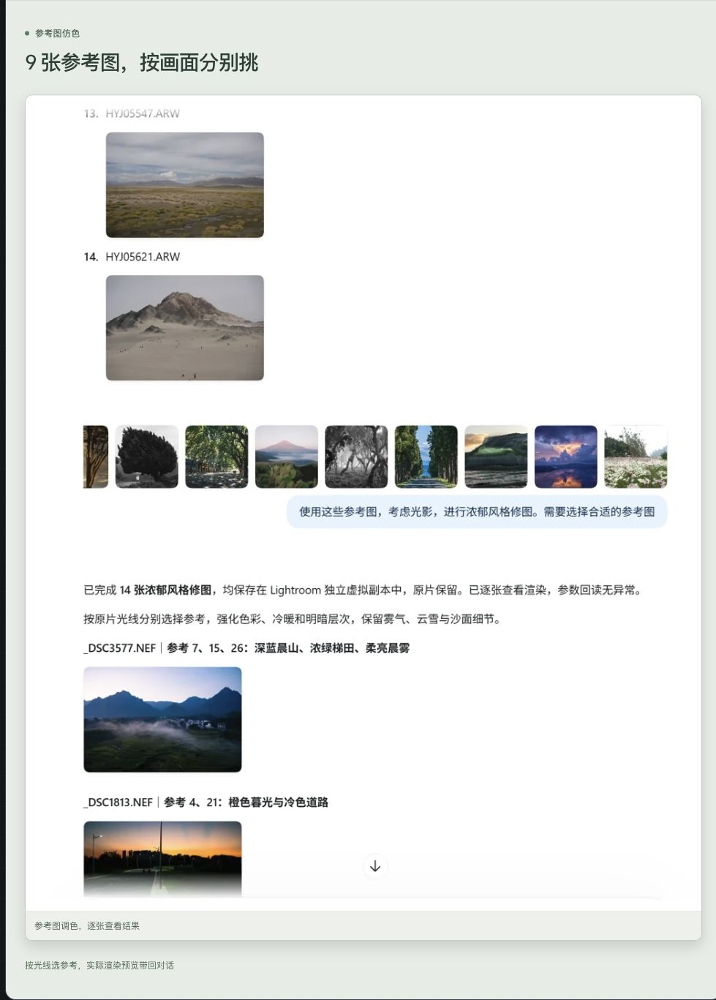
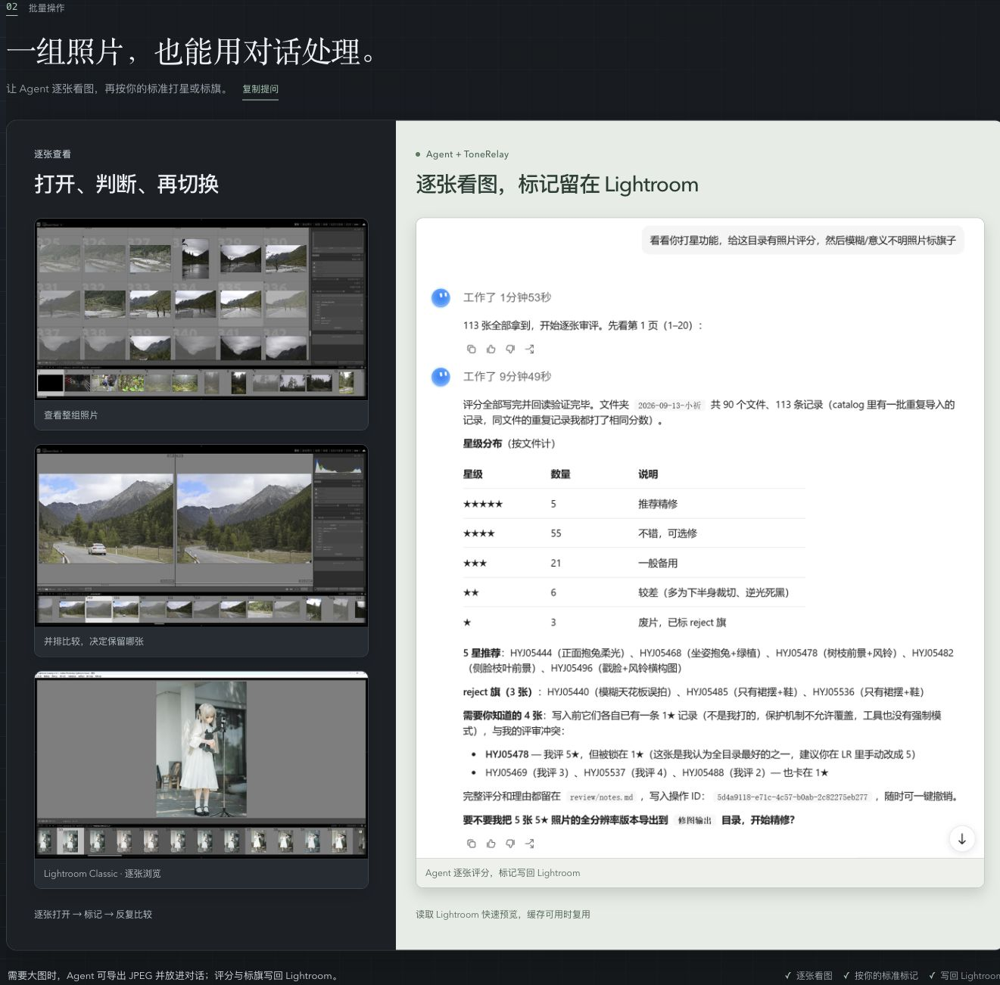

# ToneRelay — Adobe Lightroom Classic MCP

### 把想要的效果说出来，和 Agent 一起把照片修到满意。

面向摄影与 Adobe Lightroom Classic 的本地 MCP 修图工具。在对话里查看当前照片和目录预览、按参考图调色、细调人物与光影，也能整理一整组照片。看过结果后继续说哪里要改，编辑结果留在 Lightroom Classic 中。

A local Model Context Protocol (MCP) server for Adobe Lightroom Classic: conversational AI photo editing, reference-based color matching and color grading, subject masks, photo previews, and batch photo culling through an AI agent.

**[看实际效果](https://reefruan.github.io/tonerelay-portal/#experience) · [风格与效果画廊](https://reefruan.github.io/tonerelay-portal/#gallery) · [安装与使用](https://reefruan.github.io/tonerelay-portal/lightroom-classic-mcp/) · [联系作者](https://reefruan.github.io/tonerelay-portal/contact.html)**

## 看过一版，再接着修

> “感觉暗部太黑了，再调整一下。”

先讨论照片想达到的效果，或发一张喜欢的参考图。Agent 给出一版后，可以继续调整阴影、高光、冷暖和层次。下面是同一次对话中，根据反馈继续精修的实际过程。

[](assets/readme/dialogue-workflow.jpg)

左侧是 Lightroom 实际画面，右侧是参考图、两轮对话与修改结果。点击图片可看大图；[在 Portal 中继续浏览](https://reefruan.github.io/tonerelay-portal/#experience)。

## 从一张照片，到一整组照片

| 你想做的事 | 可以这样说 |
| --- | --- |
| 查看当前照片与同目录图片 | “看看我当前选中的照片，再给我看同目录的 10 张预览。” |
| 按参考图调整颜色与影调 | “参考这张图的冷暖和层次，先给当前照片试一版。” |
| 细调人物与背景 | “背景保留现在的感觉，把人物曝光和暗部再修一下。” |
| 选片与整理 | “看看这组照片，先提出星级和旗标建议，我确认后再写回。” |
| 探索风格与效果 | “看看画廊里的风格，讨论哪一种适合这张照片。” |

### 人物曝光与整体光影一起调整

> “蒙版恢复人物曝光和整体曝光。”

全局影调与主体局部调整可以配合进行。看过实际图片后继续修正亮度、边缘与画面关系。

[](assets/readme/subject-mask.jpg)

### 把参考方向用到多张照片

同一组照片的光线和主体各不相同。Agent 可以结合参考图逐张判断，再把调整结果带回 Lightroom 继续查看。

[](assets/readme/reference-color.jpg)

### 在 Lightroom 里保留选片结果

浏览、比较照片后，可以按当前任务写入星级、旗标或颜色标签，并保护已有标记。

[](assets/readme/batch-workflow.jpg)

以上图片是本次从正式 Portal 展示区重新截取的画面；其中的 Lightroom 与 Agent 对话来自作者此前的实际工作流，并非本轮重新执行修图。没有重绘照片、修改对话或虚构结果，也不作为速度或 Token 对照测试。[查看实际素材来源](https://github.com/ReefRuan/tonerelay-portal/blob/main/public/experience/SOURCES.md)。具体效果取决于照片、参考目标和所用模型。

## 开始使用

**[完整安装与恢复指南](INSTALL.md) · [日常使用指南](USAGE.md)**

准备好 Lightroom Classic 和一个支持本地 MCP 的 Agent 客户端。在 Lightroom 中打开要使用的 Catalog 并选中照片；安装完成后，在对话中说：

> 开始 Lightroom 修图。

完整安装包含 Lightroom 插件、ToneRelay MCP 和客户端启动 Skill。支持的安装入口、客户端接入和平台说明见 **[安装与使用页面](https://reefruan.github.io/tonerelay-portal/lightroom-classic-mcp/)**；也可以把 **[安装提示词](https://github.com/ReefRuan/tonerelay-portal/blob/main/docs/install-prompt.md)** 交给 Agent 执行。

## Source installation

已取得并核验本仓某个固定 commit 的源码时，需要 Python 3.10 或以上。先按 [安装指南](INSTALL.md) 将源码放入专用安装目录，再从该源码根目录运行对应平台的入口，并使用当前固定版本标识。

macOS：

```sh
python3 plugins/tonerelay-lightroom/scripts/tonerelay_bootstrap_macos.py install \
  --source-root "$HOME/Library/Application Support/ToneRelay/downloads/source" \
  --version "fixed-version-label" --manage-source
```

`--manage-source` 仅登记为这次安装新建的专用下载源码，以便卸载时按清单清理。已有开发 checkout 不加这个参数，源码只作为只读安装输入；自定义目录应与实际配置的下载位置一致。

Windows PowerShell：

```powershell
python plugins/tonerelay-lightroom/scripts/tonerelay_bootstrap.py install `
  --source-root "C:\path\to\verified-source" --version "fixed-version-label"
```

安装结果会给出 Lightroom 插件位置、维护入口、MCP 客户端配置和 `next` 步骤。两个平台都需按返回的维护入口执行 `lightroom-plugin install`，完成 Lightroom 插件注册；不能只安装 Runtime 就认为全部接入完成。按所用客户端分别完成 MCP 与 Skill 接入，再从真实对话核对连接和当前选片。macOS 与 Windows 使用各自的安装入口；原生 Windows 运行情况需在实际环境确认。[安装常见问题](https://github.com/ReefRuan/tonerelay-portal/blob/main/docs/faq.md)

macOS 客户端接入后还需用 `record-client` 登记安装清单；JSON `mcpServers` 与官方管理/TOML 配置的登记方式不同，详见[登记每个客户端](INSTALL.md#登记每个客户端macos)。Windows 原入口不支持 `--manage-source` 或 `record-client`，不要混用平台参数。

## Dependency download help

Python 依赖下载失败时，先保留安装错误与日志，再查看[公开 FAQ 的安装排障说明](https://github.com/ReefRuan/tonerelay-portal/blob/main/docs/faq.md)。如需切换 `PIP_INDEX_URL`，使用经过核验的下载源；不要禁用 TLS 校验，或从不明来源安装依赖。恢复后继续当前安装，不要以清空照片、Catalog 或编辑数据作为重装步骤。

## 关于照片与编辑

常规显影流程通过独立虚拟副本保留原片，可以查看已有版本并继续调整。星级、旗标和颜色标签会按已确认的任务写回 Catalog。RAW sidecar 等直接文件操作需要明确授权并指定目标。执行情况以 Lightroom 实际回读和返回的图像为准。

ToneRelay 是独立项目，非 Adobe 官方产品，与 Adobe 无隶属或背书关系。该集成面向 **Lightroom Classic**，不等于支持云版 Lightroom 或 Photoshop。

## 许可证

本仓库中作者原创的代码、运行 Prompt、Skill 与说明采用 [MIT License](LICENSE)。第三方依赖继续适用各自的许可证；Adobe 软件、产品及商标不由本项目授权。照片、参考图及截图素材不纳入代码的 MIT 授权，按其[来源与原许可](https://github.com/ReefRuan/tonerelay-portal/blob/main/public/experience/SOURCES.md)处理。独立的 Portal 仓库继续采用它自己的许可。

**[进入 ToneRelay Portal →](https://reefruan.github.io/tonerelay-portal/)**
